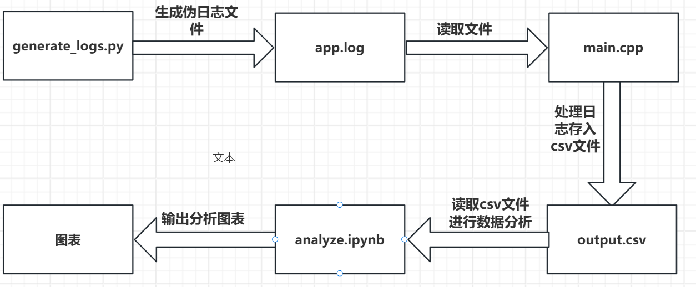
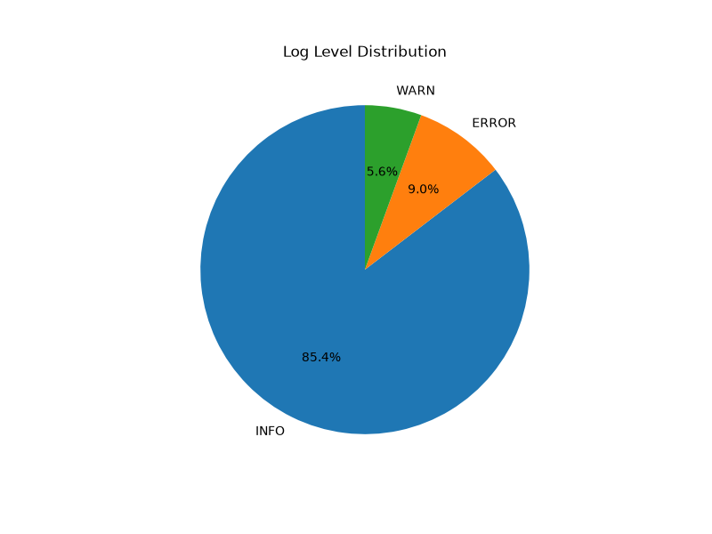
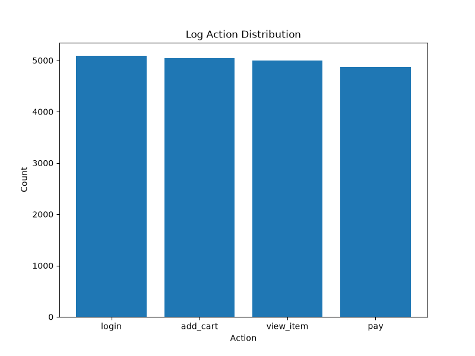
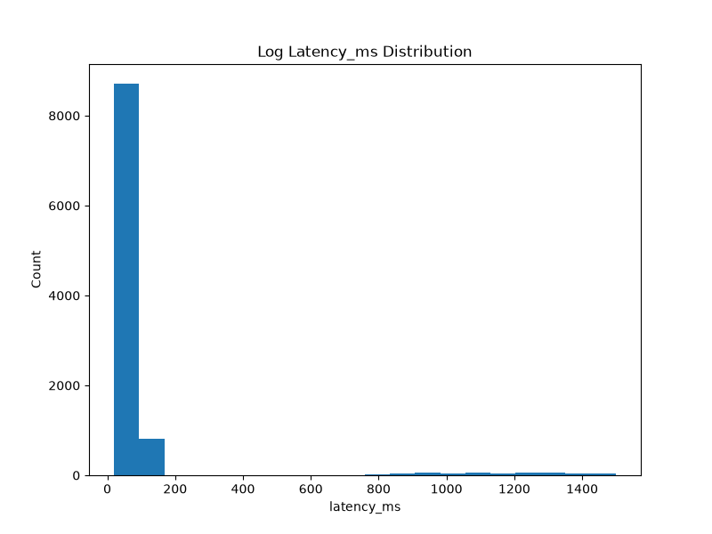
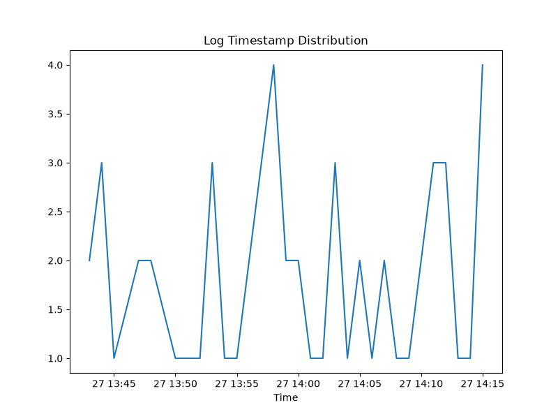
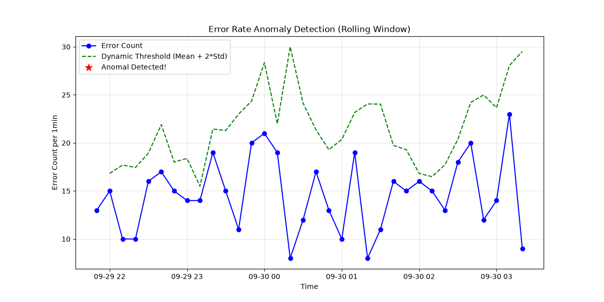

# Log Analyzer —— 轻量级日志采集、分析与异常检测系统

针对海量非结构化系统日志难以快速排查与监控的问题，独立设计并实现了一套端到端的轻量级日志处理分析流水线。涵盖故障数据模拟、C++ 高性能解析、SQLite 事务级持久化、Pandas 多维分析及基于统计学的动态异常告警。

## 🚀 核心功能与技术亮点

- **高性能日志解析引擎 (C++)**：摒弃低效的正则与流操作，采用 `find` 结合 `substr` 进行精确的指针偏移控制，实现对非结构化日志的极速切分；利用 `struct` 与 `std::vector` 构建内存结构化数据池。
- **数据库持久化与性能优化 (SQLiteCpp)**：引入 `SQLiteCpp` 第三方库替代原生 C API；采用**预编译语句（Prepared Statement）与参数绑定（bind）** 防范 SQL 注入；利用**事务（Transaction）** 将海量数据打包批量提交，将磁盘 I/O 耗时降低数个数量级。
- **多维数据分析链路 (Python)**：通过 `sqlite3` 直连数据库，使用 Pandas 的 `read_sql_query` 直接对数据进行多维聚合，计算接口调用频次、错误率及 P95/P99 延迟等核心性能指标。
- **智能异常检测模块 (Anomaly Detection)**：设计基于滑动窗口（Rolling Window）的时间序列异常检测算法。利用动态阈值（`Rolling Mean + k * Rolling Std`）替代静态硬编码，精准捕获错误率的突增风暴，并通过 Matplotlib 实现异常点的自动可视化标记。

## 🏗️ 系统架构



## 🛠️ 技术栈

- **核心语言**：C++17 (STL), Python 3
- **数据处理**：Pandas, Matplotlib, SQLite3
- **第三方库**：SQLiteCpp
- **运行环境**：Linux

## 📂 目录结构

```text
log_analyzer/
├── Analysis/                 # Python 数据分析与异常检测模块
│   └── analyze.ipynb         # 包含统计、可视化与滑动窗口检测的 Notebook
├── Convert/                  # C++ 日志解析与转换模块
│   ├── main.cpp              # 核心解析与 SQLite 入库代码
│   └── main                  # 编译后的可执行文件
├── Data/                     # 数据与图表产出目录
│   ├── generate_logs.py      # 日志生成脚本 (支持注入错误风暴)
│   ├── app.log               # 生成的模拟原始日志
│   ├── logs_output.db        # SQLite 数据库存储文件
│   ├── level_pie.png         # 日志级别分布饼图
│   ├── action_bar.png        # 动作调用统计柱状图
│   ├── latency_his.png       # 耗时分布直方图 (长尾效应)
│   ├── timestamp_error.png   # 日志量时间趋势折线图
│   └── anomaly_detection.png # 动态阈值异常检测监控图
├── SQLiteCpp/                # SQLiteCpp 开源库依赖
├── .gitignore
├── jiagou.png                # 系统架构图
└── README.md
```

## 快速开始

### 1. 生成模拟日志
```bash
    python Data/generate_logs.py
```

### 2. 编译并运行 C++ 编译器
```bash
    g++ Convert/main.cpp -o Convert/main -lSQLiteCpp -lsqlite3
    ./Convert/main
```

### 3. 运行 Python 分析
```bash
    jupyter notebook Analysis/analyze.ipynb
```

## 数据展示与异常监控

### 1. 基础业务指标监控

### 日志级别分布


### 动作调用统计


### 耗时分布


### 日志量时间趋势


### 2. 智能异常检测

- 采用滑动窗口动态阈值（均值 + 2倍标准差）自动识别错误率突增。
- 下图展示了系统成功捕获人为注入的 “错误风暴 (Error Spike)”，红色星号精准标记在风暴的上升沿。




## 后续计划与思考

- 提升阈值鲁棒性：当前的均值+标准差容易受风暴早期的离群点影响（导致阈值虚高）。下一步计划引入中位数与 MAD（中位数绝对偏差），构建对单点离群更鲁棒的检测基线。
- 多维联合监控：将错误率与 P95 延迟结合，设计联合告警规则。未来若面对更复杂的非线性时序模式，可探索引入 Isolation Forest 等无监督机器学习算法，并在可解释性与计算成本间寻找平衡。
- 实时采集网络：引入多线程与 Socket 编程，支持日志的实时网络上报与流式处理。

## 第三方依赖

本项目使用了以下开源库：

| 库名 | 许可证 | 用途 |
|------|--------|------|
| [SQLiteCpp](https://github.com/SRombauts/SQLiteCpp) | MIT | SQLite 数据库 C++ 封装，提供面向对象与 RAII 特性的接口 |
